# Phase 2, Step 2.1: database enhancement schema design

2026-11-08. **DESIGN ONLY. No migrations or application changes authorized or created.**

## Verified baseline and scope

The most recent [Phase 1 audit](phase1-database-ui-compatibility-audit.md) was rechecked against current models, migration graph, actual development schema, services and reference file inventory. Its Appendix A contains every actual column/default/PK/FK/index/check; Appendix E contains the three missing modeled tables. Those inventories are incorporated here by reference, not replaced by a conceptual schema.

The guarded read-only diagnostic freshly confirmed APP_ENV=development, SELECT DATABASE()=lankapex_db, MySQL 8.0.46, **17 application tables / 18 including alembic_version**, **20 modeled tables**, current revision **c9d5e8f7a237**, single head **03b9c2d1e671**, and 26 decodable approved PNGs. Evidence: ignored `.server-logs/phase2-schema-recheck.log` and refreshed `.server-logs/phase1-schema-inventory.json`. No application records or secrets were exported. No DB-changing tests ran. Reference screen contents remain the visually inspected approved designs documented in Phase 1; no new live browser acceptance run is claimed.

| Existing table | Development now | Responsibility retained |
|---|---|---|
| users | Present | JWT identity, role, account state, phone, language, created time |
| businesses | Present | Shop identity, type, phone/address, approval |
| business_members | Present | Active owner/staff relationship |
| customer_profiles | Present | Business-owned customer, nullable linked user |
| credit_accounts | Present | Creditor/debtor, limit, terms, status |
| ledger_entries | Present | Credit sale, repayment, reversal, due_at, idempotency, receipt |
| product_categories | Present | Business-scoped product categories |
| products | Present | Price, category, draft/published/archived, manual availability |
| orders | **Missing; modeled** | Cash/credit order, immutable amounts, exact-once credit-sale link |
| order_items | **Missing; modeled** | Product/name/price/quantity snapshots |
| driver_profiles | Present | Driver approval, legacy vehicle pair, reviewer evidence |
| delivery_requests | Present | Business-owned job, coarse areas, status |
| delivery_assignments | Present | Unique assignment and driver ownership |
| delivery_status_events | Present | Persisted status timeline |
| notifications | Present | Recipient, event key, polymorphic action reference, read state |
| payment_reminders | Present | Recorded reminder evidence, not external delivery proof |
| communication_consents | Present | Business/customer consent evidence |
| communication_attempts | Present | Manual communication handoff evidence |
| business_approval_audits | Present | Business decision audit |
| admin_audits | **Missing; modeled** | Administrative decision audit |

Pending chain, in order: d0e6f9a8b348 (orders/items and checks), e1f7a0b9c459 (order delivery link and composite business FK), f2a8b1c0d560 (notification checks), 03b9c2d1e671 (Admin audit and driver notification checks). Reconcile these before adding new feature revisions. Do not create replacements called purchase_orders, delivery_providers or deliveries.

Shared-table columns have matching effective types and nullability; inherited collations and BOOL/TINYINT, NUMERIC/DECIMAL aliases are not migration gaps. Pending delivery composite uniqueness and notification checks remain known differences. `ledger_entries.order_id` already exists without an FK; authoritative posting link is orders.credit_sale_id. Adding a new FK there is deferred until legacy provenance/orphan checks are separately authorized.

## Classification and design conventions

**Essential:** reconcile existing implemented schema; expose existing self phone/language/created time and authorized shop fields; correct query projections/pagination; preserve financial/authorization invariants. These do not justify new feature tables.

**Important recommended next milestone:** five new tables for saved addresses, vehicle details/documents and persisted user/business settings. They enable actual controls shown in approved pages, but are unnecessary for read-only layout rendering.

**Optional:** persistent-cart pair. **Deferred:** earnings/payout pair until financial policy approval; advanced disputes/group purchasing/subscriptions; inventory reservations, live location, driver presence, identity verification and security-session products. AI Summary and provider integration are excluded.

All proposed tables use InnoDB, utf8mb4, signed BIGINT IDs matching existing parents. PK IDs are AUTO_INCREMENT except one-to-one settings PKs. Datetimes are UTC DATETIME(6), API timestamps explicitly UTC; DATE means a calendar date in the documented jurisdiction. `N` means NOT NULL, `Y` nullable. `none` means no SQL default: caller must supply a validated value; NULL defaults apply only to nullable columns. `CURRENT_TIMESTAMP(6)` timestamps do not imply database triggers: updated_at is explicitly maintained on changes. Request/event keys use utf8mb4_bin. Money uses DECIMAL, never float; APIs serialize money as strings. All CHECK predicates are enforced on MySQL 8.0.46. Validate the same rules in Pydantic for useful errors.

FKs use ON DELETE RESTRICT / ON UPDATE RESTRICT unless explicitly stated. Explicit composite uniques on referenced keys avoid reliance on MySQL non-standard nonunique referenced indexes. Indexes listed below include FK support; implementation must avoid redundant single-column indexes when an existing composite prefix suffices. Cross-row authorization, aggregate sums, role membership and lifecycle transitions cannot be enforced by a MySQL CHECK; service transaction checks remain mandatory.

## Five recommended new tables

### customer_addresses — Important

Owned address book for Customer profile and checkout. Business-owned customer_profiles.address is not this data.

| Column | MySQL type | Null | Default |
|---|---|---|---|
| address_id | BIGINT | N | AUTO_INCREMENT PK |
| user_id | BIGINT | N | none |
| label | VARCHAR(50) | N | none |
| recipient_name | VARCHAR(150) | N | none |
| phone | VARCHAR(20) | Y | NULL |
| address_line | VARCHAR(500) | N | none |
| city | VARCHAR(100) | Y | NULL |
| latitude | DECIMAL(9,6) | Y | NULL |
| longitude | DECIMAL(10,6) | Y | NULL |
| archived_at | DATETIME(6) | Y | NULL |
| created_at | DATETIME(6) | N | CURRENT_TIMESTAMP(6) |
| updated_at | DATETIME(6) | N | CURRENT_TIMESTAMP(6) |

FK user_id -> users.user_id; UNIQUE(address_id,user_id); INDEX(user_id,archived_at,address_id). CHECK trimmed label/name/address nonempty; coordinates both NULL or both present, latitude between -90 and 90, longitude -180 and 180. Duplicate address strings are allowed; multiple household recipients may share an address. No implicit default flag race: preferred address is a single pointer in user_preferences.

Own-address operations derive user_id from JWT, require active Customer, reject foreign IDs with the same not-found response. Archived addresses cannot be newly selected. Snapshot order details server-side so edits/archival do not change history. Proposed address service integrates order_service; current endpoints do not yet exist. Retention: users may archive unused addresses; restrict access and erase address-book PII under an approved retention policy, separately from legally retained order snapshots. Never log address bodies.

### user_preferences — Important

One row per user for the three roles' Settings pages. Existing users.preferred_language remains authoritative; no duplicate language column.

| Column | MySQL type | Null | Default |
|---|---|---|---|
| user_id | BIGINT | N | PK, none |
| theme | VARCHAR(10) | N | 'system' |
| in_app_notifications | BOOLEAN | N | TRUE |
| email_notifications | BOOLEAN | Y | NULL |
| preferred_address_id | BIGINT | Y | NULL |
| version | INT | N | 1 |
| updated_at | DATETIME(6) | N | CURRENT_TIMESTAMP(6) |

FK user_id -> users; composite FK(preferred_address_id,user_id) -> customer_addresses(address_id,user_id); INDEX(preferred_address_id,user_id). CHECK theme IN(light,dark,system), version>=1, booleans 0/1 when set. Own-user optimistic update compares version and increments atomically. Only Customer can choose preferred_address_id; service also requires unarchived address. Service clears the pointer transactionally when archiving the default. Missing row uses documented application defaults; NULL email means unset, not consent.

Proposed preference service integrates auth and notification_service; no invented existing route. Delivery/security/financial notifications cannot be suppressed as proof of delivery or consent. Existing communication consent evidence remains authoritative for its scope. No credentials, 2FA seeds or sessions belong here. Retain while account active, then follow approved account privacy lifecycle.

### business_settings — Important

Owner defaults for future customer credit accounts and public delivery capabilities, not retroactive changes to accounts.

| Column | MySQL type | Null | Default |
|---|---|---|---|
| business_id | BIGINT | N | PK, none |
| default_credit_limit | DECIMAL(14,2) | Y | NULL |
| default_payment_term_days | INT | Y | NULL |
| delivery_enabled | BOOLEAN | N | FALSE |
| delivery_radius_km | DECIMAL(7,2) | Y | NULL |
| version | INT | N | 1 |
| updated_at | DATETIME(6) | N | CURRENT_TIMESTAMP(6) |

FK business_id -> businesses.business_id. PK suffices for owner-context lookup. CHECK limit>=0 when set; terms>0 when set; radius>0 when set; delivery_enabled IN(0,1); version>=1. Radius is a configured capability, not evidence that a route is eligible or geocoded. Missing defaults use existing explicit account creation policy. Changes do not alter existing payment_term_days/limits/due_at.

Every read/write requires active authorized owner membership plus applicable business approval policy. Proposed settings service feeds shop_owner_customer_create_service and catalogue_service projections. No payment credentials or staff authorization arrays. Retain versioned change evidence in an appropriate audit mechanism before exposing privileged edits; current admin_audits target_type/action checks do not support generic settings edits and must not be bypassed. Historical financial snapshots remain independent of current settings.

### vehicles — Important

Owned vehicle history for DriverVehicle, not a replacement for driver_profiles.

| Column | MySQL type | Null | Default |
|---|---|---|---|
| vehicle_id | BIGINT | N | AUTO_INCREMENT PK |
| driver_user_id | BIGINT | N | none |
| vehicle_type | VARCHAR(50) | N | none |
| registration_reference | VARCHAR(50) | N | none |
| make | VARCHAR(100) | Y | NULL |
| model | VARCHAR(100) | Y | NULL |
| model_year | SMALLINT | Y | NULL |
| image_storage_key | VARCHAR(500) | Y | NULL |
| lifecycle_status | VARCHAR(20) | N | 'active' |
| source | VARCHAR(20) | N | 'submitted' |
| created_at | DATETIME(6) | N | CURRENT_TIMESTAMP(6) |
| updated_at | DATETIME(6) | N | CURRENT_TIMESTAMP(6) |

FK driver_user_id -> driver_profiles.user_id; UNIQUE(vehicle_id,driver_user_id); INDEX(driver_user_id,lifecycle_status,vehicle_id). CHECK nonblank type/registration; model_year NULL or 1900..2100; lifecycle active/retired; source submitted/legacy. Global registration uniqueness is deliberately absent: format, jurisdiction, transfer and legacy values require policy. Service rejects inappropriate duplicate active vehicles within a driver's records under a locked driver row. No stored verification status duplicated from document review.

Proposed vehicle operations extend driver_service and Admin projections. Driver edits own records; Admin document review is separate; approved driver status never follows from creating a vehicle. Keep former assignment vehicle references immutable. Driver owns object; confidential registration and media only exposed where authorized. Private object storage keys, validated files, no arbitrary remote URL fetching. Retire rather than remove historically referenced vehicles; apply approved PII/document retention separately.

### vehicle_documents — Important

Private versioned submissions with separate review evidence for the Driver vehicle document UI.

| Column | MySQL type | Null | Default |
|---|---|---|---|
| document_id | BIGINT | N | AUTO_INCREMENT PK |
| vehicle_id | BIGINT | N | none |
| document_type | VARCHAR(30) | N | none |
| storage_key | VARCHAR(500) | N | none |
| content_sha256 | CHAR(64) ASCII | N | none |
| media_type | VARCHAR(100) | N | none |
| size_bytes | BIGINT | N | none |
| review_status | VARCHAR(20) | N | 'pending' |
| expires_on | DATE | Y | NULL |
| supersedes_document_id | BIGINT | Y | NULL |
| reviewed_by | BIGINT | Y | NULL |
| reviewed_at | DATETIME(6) | Y | NULL |
| rejection_reason | VARCHAR(500) | Y | NULL |
| created_at | DATETIME(6) | N | CURRENT_TIMESTAMP(6) |

FK vehicle_id -> vehicles; FK reviewed_by -> users; UNIQUE(document_id,vehicle_id); composite FK(supersedes_document_id,vehicle_id) -> vehicle_documents(document_id,vehicle_id); UNIQUE(supersedes_document_id) prevents two direct successor branches; INDEX(vehicle_id,document_type,created_at,document_id), INDEX(review_status,expires_on,document_id), reviewer index. CHECK type IN(registration,insurance,revenue_license); pending/approved/rejected; size_bytes>0; nonempty storage_key; SHA-256 hex validated in service (and REGEXP check if adopted consistently); no self-supersession. Pending requires review fields and rejection reason NULL; approved requires reviewer/time and reason NULL; rejected requires reviewer/time and nonblank reason. Expiry is **derived from expires_on**, not a second contradictory review state.

Replacement submissions are new immutable file records; service locks vehicle, ensures same document type for supersession and requires superseded record to be the current tip. Review updates are authorized once and audited; concurrent review conflict must not overwrite another decision. Need a purpose-built administrative audit extension or review-event design before enabling reviews: existing audit checks must be explicitly expanded, never store unvalidated actions. Owner and authorized Admin only; signed downloads, upload size/type/malware checks, no public directory or unmasked document identifiers in notifications. Immutable review evidence does not mean indefinite file retention: legally approved expiration/purge schedule and audited erasure are prerequisites. Driver approval remains separately enforced by driver_profiles.

## Optional persistent cart pair — complete conditional design

Current ShoppingProvider already holds a single-shop cart, and order_service server quotes and revalidates it. Add these only for reload/cross-device persistence; no frozen price entitlement or inventory reservation implied. CustomerCatalogue and ShoppingCart would use a new own-cart service integrated with existing quote/placeOrder.

| Table.column | Type | Null | Default |
|---|---|---|---|
| shopping_carts.cart_id | BIGINT | N | AUTO_INCREMENT PK |
| shopping_carts.customer_user_id | BIGINT | N | none |
| shopping_carts.business_id | BIGINT | N | none |
| shopping_carts.version | INT | N | 1 |
| shopping_carts.created_at | DATETIME(6) | N | CURRENT_TIMESTAMP(6) |
| shopping_carts.updated_at | DATETIME(6) | N | CURRENT_TIMESTAMP(6) |
| shopping_cart_items.cart_item_id | BIGINT | N | AUTO_INCREMENT PK |
| shopping_cart_items.cart_id | BIGINT | N | none |
| shopping_cart_items.business_id | BIGINT | N | none |
| shopping_cart_items.product_id | BIGINT | N | none |
| shopping_cart_items.quantity | INT | N | none |
| shopping_cart_items.updated_at | DATETIME(6) | N | CURRENT_TIMESTAMP(6) |

Carts: FKs customer_user_id -> users, business_id -> businesses; UNIQUE(customer_user_id), UNIQUE(cart_id,business_id); INDEX(business_id), INDEX(updated_at,cart_id); CHECK version>=1. This deliberately supports one current cart across businesses per customer, matching existing UI; switching shop requires explicit confirmation and transactionally replaces contents. Items: composite FK(cart_id,business_id) -> carts; composite FK(product_id,business_id) -> products, requiring additive UNIQUE(product_id,business_id); UNIQUE(cart_id,product_id); INDEX(cart_id,business_id), INDEX(product_id,business_id); CHECK quantity BETWEEN 1 AND 99. All FK deletes restricted; explicit child deletion only for a future authorized cart operation.

JWT Customer owns cart; body customer_user_id is rejected/ignored. Compare-and-increment version under lock for concurrent tabs. Quote rechecks business approval, product publication, actual price and credit eligibility. Order submission uses existing request_key/hash; clearing cart must not make a successful order retry create a new order. No cached subtotal/credit balance. Cart edits and abandoned-item deletion are not financial records. Proposed retention: expire abandoned carts after 30 days inactivity, subject to product approval; any future cleanup job must be separately authorized, bounded and target-verified. No job is created now.

## Deferred driver financial pair — conditional design, not ready to migrate

DriverEarnings is unsupported today. A delivery's customer fee is not automatically driver income. Before implementing, approve entitlement amount/time, payer, commission/tax, cancellations, refund/adjustment, cash handling, negative earnings, settlement and payout destination policy. Existing customer ledger semantics remain unchanged.

The conditional design below assumes **whole positive earning events are allocated to one payout**, no partial allocations, with an externally approved/tokenized payout destination. If those assumptions fail, redesign before migrations; do not improvise financial state from this document.

| Table.column | Type | Null | Default |
|---|---|---|---|
| driver_payouts.payout_id | BIGINT | N | AUTO_INCREMENT PK |
| driver_payouts.driver_user_id | BIGINT | N | none |
| driver_payouts.amount | DECIMAL(14,2) | N | none |
| driver_payouts.currency | CHAR(3) | N | 'LKR' |
| driver_payouts.status | VARCHAR(20) | N | 'pending' |
| driver_payouts.request_key | VARCHAR(100) utf8mb4_bin | N | none |
| driver_payouts.destination_token | VARCHAR(255) | N | none |
| driver_payouts.provider_reference | VARCHAR(100) utf8mb4_bin | Y | NULL |
| driver_payouts.requested_at | DATETIME(6) | N | CURRENT_TIMESTAMP(6) |
| driver_payouts.settled_at | DATETIME(6) | Y | NULL |
| driver_earnings.earning_id | BIGINT | N | AUTO_INCREMENT PK |
| driver_earnings.assignment_id | BIGINT | N | none |
| driver_earnings.driver_user_id | BIGINT | N | none |
| driver_earnings.event_kind | VARCHAR(20) | N | none |
| driver_earnings.amount | DECIMAL(14,2) | N | none |
| driver_earnings.currency | CHAR(3) | N | 'LKR' |
| driver_earnings.event_key | VARCHAR(100) utf8mb4_bin | N | none |
| driver_earnings.policy_version | VARCHAR(30) | N | none |
| driver_earnings.reverses_earning_id | BIGINT | Y | NULL |
| driver_earnings.payout_id | BIGINT | Y | NULL |
| driver_earnings.base_assignment_id | BIGINT | Y | STORED generated: CASE WHEN event_kind='base' THEN assignment_id ELSE NULL END |
| driver_earnings.recorded_at | DATETIME(6) | N | CURRENT_TIMESTAMP(6) |

Payouts: FK driver_user_id -> driver_profiles; UNIQUE(payout_id,driver_user_id); UNIQUE(driver_user_id,request_key); UNIQUE(provider_reference); INDEX(driver_user_id,requested_at,payout_id), INDEX(status,requested_at,payout_id). CHECK amount>0/currency='LKR'; status pending/processing/paid/failed; settled_at set iff paid. No supplied client amount can determine payable entitlement. Destination tokens are sensitive, not returned in full to other actors and not logged; external token ownership must be independently verified. This does not design a provider integration.

Earnings: additive UNIQUE(assignment_id,driver_user_id) on delivery_assignments; composite FK(assignment_id,driver_user_id) -> assignments; UNIQUE(earning_id,assignment_id,driver_user_id); composite self FK(reverses_earning_id,assignment_id,driver_user_id) -> same earning/assignment/driver; composite FK(payout_id,driver_user_id) -> payouts; UNIQUE(event_key), UNIQUE(base_assignment_id), UNIQUE(reverses_earning_id); INDEX(assignment_id,driver_user_id), INDEX(reverses_earning_id,assignment_id,driver_user_id), INDEX(payout_id,driver_user_id), INDEX(driver_user_id,recorded_at,earning_id). CHECK kind IN(base,adjustment,reversal); amount!=0; base positive; currency LKR; reversal link present iff reversal kind, no self reversal. Service enforces reversal is exactly negative of same assignment/driver original, does not reverse a reversal, and idempotent entitlement is created once after qualifying persisted delivery event. Policy_version nonblank.

Amount/kind/original relationship are immutable; correcting money appends an adjustment/reversal, not UPDATE amount. A positive unallocated event can have payout_id bound once while locking driver settlement, eligible earnings, and payout; sum(amount) must equal payout.amount in that transaction. Negative adjustments block further payout pending an approved offset policy; they cannot be silently omitted to inflate withdrawable funds. Paid payout and allocation never cleared. Failed submission retries the same payout/provider idempotency key; uncertain provider outcome freezes allocation until reconciliation. Audit transitions and verify provider settlement before marking paid. If offsets/splits/multiple settlement attempts need richer allocation history, add driver_payout_items and payout events under a separate design; the nine candidate tables alone are not sufficient for every payment policy.

Proposed financial service would integrate driver_service completion transaction or an idempotent after-commit event handler, existing notification_service and authorized Admin settlement. No actual payout endpoint exists. Driver can view own earning/payout projections and request payout; cannot set amount, allocation, provider outcome or Admin state. Never expose customer credit ledgers through driver earnings. Financial retention follows approved accounting law; retain audit and reversal chains, minimize destination tokens and enforce restricted operations. Design remains deferred until policy and audit/reconciliation dependencies are resolved.

## Existing-table extensions: only new columns

All fields in this section are new proposals, nullable with default NULL unless expressly stated. Nullable legacy data means unknown, not empty/zero/verified. Unlisted existing columns retain their definitions and semantics.

| Table | New column(s), type and checks | Why / service / priority |
|---|---|---|
| businesses | logo_storage_key VARCHAR(500); public_description VARCHAR(2000); city VARCHAR(100); latitude DECIMAL(9,6), longitude DECIMAL(10,6), paired/range checks; opening_hours JSON with service-validated weekday/time schema | Browse shops/shop settings; catalogue_service and future owner business update; Important. Existing business_type covers shop classification; product categories remain product_categories. No duplicate category string or new taxonomy table without real filtering requirements. Existing phone/address already stored. |
| products | image_storage_key VARCHAR(500); unit_label VARCHAR(30), nonblank when set | Product cards/editor; catalogue_service; Important. Existing publication_status and availability_status are already present: **do not add them**. One image per product is sufficient initial scope; gallery/multiple images would need a separate design. |
| users | avatar_storage_key VARCHAR(500), validated private upload reference | Optional profile image; Important conditional. Existing phone/preferred_language/created_at need DTO changes only. No mandatory DOB/NIC/gender inferred from screenshots. |
| orders | fulfillment_method VARCHAR(20), CHECK NULL or pickup/delivery; recipient_name VARCHAR(150), recipient_phone VARCHAR(20), delivery_address VARCHAR(500), delivery_latitude DECIMAL(9,6), delivery_longitude DECIMAL(10,6), delivery_instructions VARCHAR(1000); paired/range checks | Checkout/customer tracking/owner fulfilment; order_service/order_delivery_service; Important. New delivery orders require snapshot recipient/address in service; existing NULL stays unknown. No address FK needed: snapshot survives address edits. Include every binding snapshot in idempotency request_hash. |
| driver_profiles | active_vehicle_id BIGINT | Important with vehicles. Composite FK(active_vehicle_id,user_id) -> vehicles(vehicle_id,driver_user_id); index(active_vehicle_id,user_id). Driver approval and vehicle selection are independent. Selection transaction requires active own vehicle and required reviewed/unexpired documents once policy activated. Do not turn this into automatic rejection of legacy drivers without a rollout decision. |
| delivery_assignments | vehicle_id BIGINT | Important conditional historical vehicle snapshot. Composite FK(vehicle_id,driver_user_id) -> vehicles(vehicle_id,driver_user_id), supporting composite index. Captured at acceptance; later driver selection does not rewrite it. Keep existing unique delivery_request_id. |
| delivery_requests | pickup_address VARCHAR(500); destination_address VARCHAR(500); recipient_name VARCHAR(150); recipient_phone VARCHAR(20); instructions VARCHAR(1000); pickup_latitude DECIMAL(9,6), pickup_longitude DECIMAL(10,6); destination_latitude DECIMAL(9,6), destination_longitude DECIMAL(10,6); required_vehicle_type VARCHAR(50) | Important owner job/detail/tracking; shop_owner_delivery_service/driver_service/order_delivery_service. Paired coordinate/range checks. NULL vehicle requirement means no added vehicle-type restriction; when present normalize against approved type list and enforce on server acceptance. Public jobs expose existing coarse areas; private snapshots only operationally authorized. Standalone job snapshot differs from original order snapshot; copy authorized order snapshot on request creation, not ongoing synchronization. |

No new stored category/rating/verified flag is inferred for businesses. No new customer_profiles contact columns are required; existing name/phone/address and user linkage cover present use. No new credit_accounts terms/due-date fields: terms already exist and ledger_entries.due_at is sale-specific. No new notifications read/action fields: is_read/read_at/related_entity_type/id already exist; validate related-object ownership on action access rather than store arbitrary action URLs. Keep recipient event deduplication and extend allowed types only with real domain operations.

**Deferred inventory:** do not add stock_quantity/low_stock_threshold until stock ownership, movements, reservations, unit precision and order approval/cancellation consumption are designed. Manual availability is not numeric inventory. No count allocation is made for future stock movements.

**Deferred fees:** if approved later, add nullable orders.delivery_fee DECIMAL(14,2), orders.pricing_policy_version VARCHAR(30), delivery_requests.quoted_fee DECIMAL(14,2), currency CHAR(3), pricing_policy_version VARCHAR(30). CHECK fees>=0 when known; request fee and currency paired, LKR only initially. These are contractual snapshots, not balance caches. Existing ck_order_total enforces subtotal=total: changing to subtotal+fee requires an explicit decision whether fees enter customer credit debt, separate payout entitlement, tax and refund rules. Keep existing check and old totals until then; do not infer a free fee of 0 from NULL. Existing cash order payment_status stays unpaid; cash collection needs a separate audited design, not a new cosmetic paid field.

**Deferred availability:** an online/offline boolean on driver_profiles cannot prove current presence. Need opt-in availability plus expiring heartbeat timestamps, freshness, privacy and assignment policy before adding presence; current UI must say unavailable. Exact location/GPS/ETA is separate consent/retention/service work.

## Financial and security invariants

Current ledger_service calculates effective entries by excluding reversed originals and counting credit_sale positive / repayment negative. Balance B = effective sales - effective repayments; outstanding=max(B,0), advance=max(-B,0), available_credit=max(limit-outstanding,0), preserving existing advance semantics. No new materialized customer totals. Design example only, **not an executed test**: sale 1,000 -> repayment 300 -> repayment 700 yields B 1,000 -> 700 -> 0; reverse 300 repayment then B=300. Reversal records and original amounts remain unchanged. Page limits and filters never define the balance. Aging requires approved allocation and historical cutoff policy; due_at alone does not allocate partial repayments.

order_service uses locking/current reads, scoped customer-account resolution, request hashes and unique credit_sale_id. Pending/rejected/cancelled unposted credit orders create no debt; authorized approval writes the one ledger sale and order link atomically. Retrying approval cannot post another debt. Existing credit financial-state CHECK stays intact; cash has no credit-account/sale link. Snapshot/address/media additions cannot change that behavior.

driver_service locks actor/profile and delivery ownership, checks active account/approved driver/approved business, and uniquely assigns each request. Preserve lock order and current reads after waits. Server transitions remain available -> assigned -> picked_up -> in_transit -> delivered; existing owner cancellation only from available/assigned. Driver cannot self-approve, accept another driver's assigned delivery, override expected status or cancel via a fabricated transition. Vehicle checks are additive and must be applied transactionally without removing uniqueness protections.

Backend JWT identity is the ownership root. Customer account reads require linked customer_profiles.user_id plus matching business/creditor scope. Owner queries require membership and exact business; Driver queries require assignment driver identity; notifications recipient identity. Composite FKs add structural checks but do not replace these queries. Unknown and foreign IDs use indistinguishable not-found errors; never reveal another user's financial record existence. New tables never widen existing DTOs to private ledger/contact/document fields. Explicitly authorize all signed media downloads and polymorphic notification targets. Preserve Admin audit records and require authenticated authorized Admin for approval/review/settlement.

## All 26 screens: schema and API change allocation

The detailed existing route/component/frontend-service trace remains in Phase 1. All existing APIs use /api/v1. New service operations below are proposals, **not claims of existing routes**.

| Approved reference | Existing source tables | Proposed schema / backend work |
|---|---|---|
| Owner 01 Dashboard | profiles/accounts/ledger/businesses | Derived scoped today/count/report projections; no dashboard table |
| Owner 02 Customers | customer_profiles/credit_accounts/ledger | Existing contacts; scoped server search/page; future settings defaults only |
| Owner 03 Credit Sales | accounts/ledger; orders/items for itemized flow | Reuse order lines for product purchases; no duplicate purchase_orders; direct manual sale remains amount-based |
| Owner 04 Repayments | ledger/accounts/profiles | No new table; existing receipts/partial/full repayments retained |
| Owner 05 Credit Orders | orders/items/ledger/accounts | Missing existing migrations first; fulfillment snapshots then optional fees under policy |
| Owner 06 Deliveries | requests/assignments/events/orders | Private snapshots and vehicle requirement; owner-scoped delivery projection |
| Owner 07 Shop & Products | businesses/products/categories | Media/public shop detail fields; existing availability/publication retained |
| Owner 08 Reports | ledger/accounts/orders/deliveries | Derived period/aging API after allocation rules; no charts table |
| Owner 09 Notifications | notifications/reminders/consents/attempts | Existing read/action fields; preferences only for user-configurable behavior |
| Owner 10 Settings | users/businesses/members | business_settings/user_preferences; existing contact/language DTOs |
| Customer 01 Dashboard | profiles/accounts/ledger/orders | Derived scoped summary; due policy unresolved; no summary table |
| Customer 02 Browse Shops | businesses/products/categories | Safe public imagery/location/settings capability projection |
| Customer 03 Shop Products | products/categories/businesses | Product image/unit; optional persistent cart pair |
| Customer 04 Shopping Cart | products/orders/items/accounts | Address snapshot/book; optional cart persistence; quote validates everything |
| Customer 05 My Orders | orders/items/requests/events | Fulfillment snapshot/projection; status not cash-paid inference |
| Customer 06 My Credit Accounts | accounts/profiles/ledger | No stored balance additions; owned statements and repayment history |
| Customer 07 My Deliveries | orders/requests/assignments/events | Authorized paginated aggregate projection, replacing first-page fan-out; private details only with policy |
| Customer 08 Notifications | notifications | Recipient scope/read state already present; preferences optional controls |
| Customer 09 My Profile | users | Existing phone/time DTO, optional avatar, customer_addresses |
| Customer 10 Settings | users | user_preferences; language stays existing users field |
| Driver 01 Dashboard | profiles/requests/assignments/events | Counts derived; no fabricated online/earnings; preserve user removal of profile section |
| Driver 02 My Deliveries | requests/assignments/events | Exact detail/vehicle snapshot; preserve status and assignment ownership |
| Driver 03 My Earnings | None currently | Conditional deferred earning/payout service, no synthetic production amounts |
| Driver 04 My Vehicle | driver_profiles legacy vehicle pair | vehicles/vehicle_documents, active selection and reviewed private files |
| Driver 05 Notifications | notifications | Existing recipient events/read state; domain events only after implementation |
| Driver 06 My Profile | users/driver_profiles | Safe self DTO/optional avatar; no identity verification inference |

No frontend layout/color change is needed to create this schema. Future service/hook updates should retain current components and honest empty/unavailable/loading/error states. Filtering only loaded pages must not be marketed as global search. Missing DTO fields are not automatically missing columns.

## Advanced feature evaluation

| Candidate | Decision | Reason / prerequisite |
|---|---|---|
| disputes | Deferred; no proposed columns/migration | No existing approved dispute lifecycle, participants, evidence access, resolution authority or debt effect. Requires separate design; never edit ledger to resolve a claim. |
| group_purchases | Deferred; no proposed columns/migration | No defined organizer, supplier/owner authorization, shared price, cancellation/expiry or order creation rules. Existing orders remain source of individual obligations. |
| group_participations | Deferred with group_purchases | Need unique membership/quantity, consent, per-member debt/repayment isolation and race-safe capacity rules; no shared customer debt assumption. |
| subscriptions | Deferred; no proposed columns/migration | No recurring contract, mandate, billing schedule/timezone, failed collection or cancellation rules. Notification preference is not a subscription or charge authorization. |

These are explicitly evaluated as not genuinely required for the approved core 26 screens. Inventing complete tables now would encode unsupported obligations. They are excluded from the table count and must receive separate authorization and domain design. AI summaries remain wholly deferred, with no provider schema/configuration.

## Relationships: proposed ER diagram

Solid relationships include both existing and proposed tables; proposed names are identified in the surrounding specification. Financial/cart branches are conditional and excluded from the recommended milestone. This diagram is a relationship overview; the composite FK and optionality definitions above are authoritative.

```mermaid
erDiagram
    users ||--o{ business_members : member
    businesses ||--o{ business_members : membership
    businesses ||--o{ customer_profiles : owns
    users o|--o{ customer_profiles : linked
    customer_profiles o|--o| credit_accounts : customer_debtor
    businesses ||--o{ credit_accounts : creditor
    businesses o|--o{ credit_accounts : business_debtor
    credit_accounts ||--o{ ledger_entries : records
    ledger_entries o|--o| ledger_entries : reverses
    users ||--o{ ledger_entries : records_as_actor
    businesses ||--o{ product_categories : groups
    businesses ||--o{ products : publishes
    product_categories o|--o{ products : categorizes
    users ||--o{ orders : places
    businesses ||--o{ orders : receives
    orders ||--|{ order_items : contains
    products ||--o{ order_items : snapshots
    credit_accounts o|--o{ orders : credit_account
    ledger_entries o|--o| orders : credit_sale
    delivery_requests o|--o| orders : delivery_link
    users ||--o| driver_profiles : driver_identity
    businesses ||--o{ delivery_requests : requests
    delivery_requests ||--o| delivery_assignments : assigned_once
    driver_profiles ||--o{ delivery_assignments : driver
    delivery_requests ||--o{ delivery_status_events : progresses
    users ||--o{ notifications : recipient
    users ||--o{ admin_audits : administrator
    businesses ||--o{ business_approval_audits : approval_history
    credit_accounts ||--o{ payment_reminders : reminder
    customer_profiles ||--o{ communication_consents : consent
    communication_consents ||--o{ communication_attempts : evidence
    payment_reminders ||--o{ communication_attempts : handoff
    users ||--o{ customer_addresses : owns
    users ||--o| user_preferences : preferences
    customer_addresses o|--o| user_preferences : preferred_address
    businesses ||--o| business_settings : defaults
    driver_profiles ||--o{ vehicles : owns
    vehicles o|--o| driver_profiles : active_selection
    vehicles ||--o{ vehicle_documents : documents
    vehicles o|--o{ delivery_assignments : historical_vehicle
    users ||--o| shopping_carts : optional_cart
    businesses ||--o{ shopping_carts : cart_shop
    shopping_carts ||--o{ shopping_cart_items : optional_items
    products ||--o{ shopping_cart_items : cart_product
    delivery_assignments ||--o{ driver_earnings : conditional_entitlement
    driver_profiles ||--o{ driver_earnings : earns
    driver_profiles ||--o{ driver_payouts : receives
    driver_payouts o|--o{ driver_earnings : whole_event_allocation
```

## Migration dependency and compatibility plan

No new revision IDs are allocated in this design. Proposed logical packages:

1. **Existing baseline**: reviewed current pending chain in dependency order, with tested backup/restore and preflight checks. Do not stamp or skip constraints. Fresh migration execution remains **BLOCKED** by the previously documented isolated verification database permission failure. Required DBA action is in [database operations](day17-database-operations.md). No elevated creation retry or administrator password is requested.
2. **Media/public metadata**: additive nullable business/product/user fields. Expose existing safe fields before adding duplicates. No automatic remote downloads.
3. **Addressbook**: customer_addresses including composite unique; then user_preferences with default-address composite FK. Nullable/default missing-row behavior keeps existing users working.
4. **Business defaults**: business_settings. No historical account/ledger changes. No automatic enabling of delivery.
5. **Vehicles**: vehicles first, documents second, then nullable driver_profiles.active_vehicle_id and assignment.vehicle_id composite FKs. Circular active selection added after both parents exist. Review audit extension must be designed/authorized before document review goes live.
6. **Delivery snapshots**: nullable order/request detail fields and normalized vehicle requirement. Copy snapshots only for newly created authorized requests. Preserve existing order link uniqueness and existing lifecycle.
7. **Optional carts**: referenced product composite unique, shopping_carts, then items. Roll out optional persistence after quote/order contract tests.
8. **Deferred finances**: only after separate decisions/audit design: assignment composite unique, driver_payouts, driver_earnings, reconciliation and settlement security. Any partial payout model requires a new allocation design before this package.

Do not backfill unknown address, vehicle make/model, document approval, fees, paid states, online presence or earnings. Existing profile vehicle strings remain legacy unverified values. A future approved migration may import them with source=legacy only after validating that both fields are present; active selection and document approval cannot be inferred. No import is executed here. Old orders keep NULL fulfillment snapshot, old assignments keep NULL vehicle; API states unknown. Retain the existing pair during compatibility rollout; dual writes/reads need one clear canonical source and idempotency before eventual deprecation, with no column removal in this plan.

Default-address/vehicle ownership composite indexes must be created before FK attachment. Validate duplicates and orphan relationships read-only before adding constraints; no automatic repair. Notification CHECK replacement must be compatible with rows at **every intermediate revision**. MySQL DDL may commit/lock; application transaction rollback does not undo it. Existing financial downgrades intentionally refuse destructive removal; use tested forward correction or approved restore strategy.

Verification for a later authorized implementation: upgrade empty isolated target, upgrade representative synthetic legacy state, verify all constraints/indexes/defaults; JWT/role and foreign-object denial for every new API; address archival/default races; cart version conflicts/idempotent order replay; concurrent vehicle/document review; assignment races/lifecycle; decimal sale/partial/full repayment/reversal; no-debt pending/rejected and exactly-once approval; recipient notifications; API backward compatibility; all 26 page contracts and responsive visual comparison. Database writes must use verified isolated testing targets, never lankapex_db. No such tests were run during this design task.

## Estimated table count and authorization boundary

| Milestone | Application tables, excluding alembic_version |
|---|---:|
| Verified now | 17 |
| Existing modeled baseline | 20 |
| Recommended five important additions | **25** |
| With optional cart pair | 27 |
| With conditional financial pair | 29 |
| If separately designed split-payout allocation is required | At least 30 |

Audit/reconciliation event storage, inventory, disputes, recurring billing, grouping or payment-destination history may add tables after their separate design. They are not secretly included in 25/29. No final count can promise those deferred capabilities before scope decisions. Existing audit table extensions may be sufficient for some review actions, but current enum checks and polymorphic target validation must be consciously revised.

Implement first the current migration prerequisites and safe DTO/query gaps, then the five recommended additions, then independently approved optional scope. **Stop here: explicit user authorization is required before creating any migrations or application implementation.** The design is complete; migration execution verification remains BLOCKED and AI Summary remains deferred.
